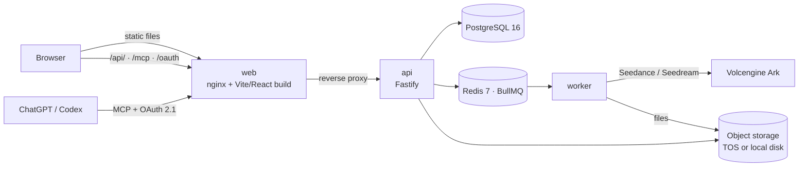

<p align="center">
  <a href="README.md">简体中文</a> · <strong>English</strong>
</p>

<p align="center">
  
</p>

<h1 align="center">Lindyson AI Video Generator</h1>

<p align="center"><strong>Turn one product photo into publish-ready short videos and product images</strong></p>

<p align="center">
  An AI video and image generation workspace for e-commerce and short-video teams.<br>
  Credits, subscription plans, an admin console and an MCP endpoint are built in. Rebrand it and launch your own AI generation service.
</p>

<p align="center">
  <a href="CHANGELOG.md"></a>
  <a href="https://github.com/orylite/lindyson-ai/actions/workflows/ci.yml"></a>
  <a href="https://github.com/orylite/lindyson-ai/security/code-scanning"></a>
  <a href="MCP_CHATGPT.md"></a>
  <a href="LICENSE"></a>
  
  
  <a href="https://www.lindyson.com"></a>
</p>

<p align="center">
  <a href="#-try-it-in-five-minutes">Try it</a> ·
  <a href="#-features">Features</a> ·
  <a href="#-accounts-and-keys-you-need">Keys</a> ·
  <a href="#-deploy-to-production">Deploy</a> ·
  <a href="#-faq-backup-and-upgrade">FAQ</a> ·
  <a href="#-development-guide">Development</a> ·
  <a href="CONTRIBUTING.md">Contributing</a> ·
  <a href="SECURITY.md">Security</a> ·
  <a href="#-contact">Contact</a>
</p>

> [!NOTE]
> The product UI and the in-repo docs other than this file are in Simplified Chinese. The code, environment variables and commands are the same in both languages.

---

## 💡 Why We Open-Sourced This

> We are cross-border sellers on TikTok ourselves, and a lot of the time we run our business on AI-generated video. Compared with shooting, it saves a lot of money and, honestly, it is easier to make something go viral. At seller meetups, more and more people came to us asking whether we could make videos for them too.
>
> Over time we realized our own script writers and video people simply could not keep up with that much demand. That also told us the market is real.
>
> So we built this system and are opening it up for everyone to use. The key part is the prompt system we refined on our own business: a customer uploads one photo, the system produces three prompt plans, and submitting one as-is already gives a very good result.
>
> Those prompt plans are not set in stone. You are free to strengthen or rewrite them around your own content style, the skills you have accumulated, or your own logic, so the plans it produces fit your categories and your playbook.
>
> **Who it helps:**
> - Sellers running their own stores: upload a product photo, get three finished videos in different styles within about ten minutes, publish to TikTok.
> - Agencies and MCN teams: batch generation across accounts and products, assets archived in one place, costs tracked in credits.
> - Developers building AI generation products: a complete skeleton with billing, admin and an MCP endpoint, so you do not start from zero.
>
> **Commercial use is welcome.** The code is Apache-2.0. Put your own brand on it and go live; you do not need to tell us and there is no revenue share. A few directions we think are worth doing:
> - Private deployment for your own team or clients, on your own Volcengine account, with fully controlled costs.
> - Plug in other multimodal models. The provider layer is isolated, so changing one place under `apps/api/src/providers/` lets you swap in or run alongside models such as ChatGPT's Image 2.5 or MiniMax's H3, and let users pick by quality and price inside the same workspace.
> - Connect your own payment channel and run it as a SaaS; plans, credits, orders and invoices are already there.
> - Pull the prompt engine out on its own and integrate it into the sourcing or operations tools you already have.
>
> The only requirement is not to use the "Lindyson" name and marks, see [TRADEMARK.md](TRADEMARK.md). If you build something interesting, come back and tell us in an issue.
>
> And if you are also a cross-border seller or in the TikTok business, whether or not you use this project, we would love to talk: product selection, making AI videos that go viral, which markets are good right now. We deal with these every day. Contact details are at the end under [Contact](#-contact).

---

## 📸 Screenshots

### Website

| Publish preview | Pricing |
|---|---|
|  |  |

### User side

| Dashboard | AI Studio: video generation |
|---|---|
|  |  |
| **Digital assets** | **TikTok accounts** |
|  |  |
| **Publish to TikTok** | **Account center: credits and MCP connection** |
|  |  |

### Prompt engine (core feature)

TK Prompt Engine starts from one product photo: it extracts product facts for you to confirm, lets you set the target market, voice-over language and visual approach, then generates three execution-ready storyboard prompts, "safest", "most native" and "most eye-catching". Pick one and it is written back to AI Studio.

| Step 1: confirm product facts | Step 2: market and creative settings | Step 3: three prompt plans |
|---|---|---|
|  |  |  |

### Admin console


---

## 🚀 Try It in Five Minutes

> [!TIP]
> No Volcengine account and no API keys needed. Demo mode swaps the real models for a "fake provider" that returns a placeholder about 1.5 seconds after each generation request, so the whole flow (upload, generate, assets, credits, admin) works end to end.

**You need**: a machine with [Docker Desktop](https://www.docker.com/products/docker-desktop/) (or Docker Engine with Compose v2.24 or newer) and at least 4 GB of free memory.

**Step 1: clone**

```bash
git clone https://github.com/orylite/lindyson-ai.git && cd lindyson-ai
```

**Step 2: one command to start**

```bash
docker compose --env-file .env.demo -f docker-compose.yml -f docker-compose.demo.yml up -d --build
```

The first run builds the images, which takes about 3 to 5 minutes. Afterwards `docker compose ps` should show five running containers, `postgres`, `redis`, `api`, `worker` and `web`, with `migrate` exited (exit 0).

**Step 3: open the browser**

Go to <http://localhost:8080>, click "登录" (Sign in) and use the demo admin:

| Email | Password |
|---|---|
| `admin@example.com` | `Demo12345` |

Open AI Studio, upload any image and click generate. The task completes in about two seconds and a placeholder result shows up under digital assets. Then have a look at the admin console: users, orders, tickets and provider usage.

**Stop and clean up**

```bash
docker compose --env-file .env.demo -f docker-compose.yml -f docker-compose.demo.yml down
```

Add `--volumes` at the end to delete the data as well.

> [!NOTE]
> The demo secrets and account are public, and the server refuses to start with these values in production mode, so they cannot be misused for a real deployment. To generate real videos, see [Deploy to Production](#-deploy-to-production).

---

## ✨ Features

- 🎬 **AI Studio**: text-to-video, image-to-video, reference asset reuse, product image generation and interactive editing. The prompt wizard turns product information into storyboard scripts.
- 🧠 **Prompt engine**: extracts facts from a product photo and generates three execution-ready storyboard prompts for the target market and voice-over language.
- 🗂️ **Digital assets**: uploads, folders, thumbnails and batch operations, with images and videos managed together.
- 💳 **Credits and subscriptions**: plans, add-on packs, credit ledger, orders and invoices. Payment channels are configured in the admin console.
- 🛠️ **Admin console**: users, orders, tickets, announcements, payment channels, provider usage and cost reports.
- 🔌 **MCP**: a standard MCP server with OAuth 2.1 dynamic registration and PKCE, so ChatGPT and Codex can import assets and start generations directly. See [MCP_CHATGPT.md](MCP_CHATGPT.md).
- 📱 **TikTok publishing**: account management and publish preview; push finished videos straight to TikTok.
- 🧑 **Real portrait library**: consent, liveness check and revocation flows for real-person likenesses, with sensitive data stored encrypted.

---

## 🔑 Accounts and Keys You Need

The demo needs no keys. To generate real content and serve users, prepare the three groups below. Everything goes into `.env`; the full reference is [.env.example](.env.example).

> [!NOTE]
> Generation is built on **Volcengine Ark**, ByteDance's model service platform. **Seedance** is its video generation model, **Seedream** is its image generation and editing model, and **TOS** is Volcengine's object storage.

### Required: nothing real gets generated without these

| What | Where to get it | Variable |
|---|---|---|
| Ark API key | Sign in to the [Volcengine console](https://console.volcengine.com/ark), open Ark, create a key under API Key management, then enable these models under model activation: Seedance 2.0 (including fast and mini), Seedance 2.5, Seedream 5.0 Pro, and Doubao Seed 2.0 lite (used by the prompt engine). Pay-as-you-go; a small top-up is enough to start. | `ARK_API_KEY` |
| Object storage | Create a private bucket in Volcengine TOS, then create an IAM sub-user with read/write access to that bucket only and take its access key. Any S3-compatible storage also works. | `STORAGE_DRIVER=tos` and `TOS_*` |

> [!TIP]
> You are not locked into Volcengine. Generation goes through an isolated provider layer (`apps/api/src/providers/`) with one interface for video and one for images. To add ChatGPT's Image models, Google's Nano Banana or any other mainstream image or video model, write one provider following the existing Ark implementation and offer it to users alongside.

### Optional by feature: leave it empty and the feature is off

| Feature | What | Variable |
|---|---|---|
| Prompt engine | Reuses the Ark key above by default; it works as soon as Doubao Seed 2.0 lite is enabled. Create a separate key if you want separate billing. This layer is swappable too: DeepSeek or any other multimodal model can write the plans, and a different model with a tweaked strategy may give you something new to play with | `ARK_PROMPT_WIZARD_API_KEY` |
| Real portrait library | A Volcengine IAM sub-user access key for the Ark Assets API. Cannot reuse the Ark API key | `REAL_PORTRAIT_PROVIDER_MODE=volcengine` and `VOLC_ARK_ASSET_*` |
| Cost reports | A read-only access key for the Volcengine billing center, used to reconcile bills and resource packs in the admin console | `VOLC_BILLING_*` |
| Transactional email | A [Resend](https://resend.com) account with a verified sending domain | `RESEND_*` |
| ChatGPT / Codex access | No external account; your site just needs a public HTTPS address | `MCP_*`, steps in [MCP_CHATGPT.md](MCP_CHATGPT.md) |
| Baidu URL submission | A push token from Baidu Webmaster Tools | `BAIDU_*` |

### Generate yourself: five random secrets

These are not issued by anyone; generate them locally, one different value each, never reused:

| Variable | Purpose | How |
|---|---|---|
| `JWT_SECRET` | Signs login sessions | `openssl rand -hex 32` |
| `MCP_OAUTH_SECRET` | Signs MCP OAuth tokens | `openssl rand -hex 32` |
| `MCP_FILE_ENCRYPTION_KEY` | Encrypts files imported through MCP | `openssl rand -hex 32` |
| `REAL_PORTRAIT_TOKEN_ENCRYPTION_KEY` | Encrypts real portrait credentials | `openssl rand -hex 32` |
| `PAYMENT_CONFIG_ENCRYPTION_KEY` | Encrypts payment channel secrets at rest | `openssl rand -base64 32` (must be 32 bytes, Base64) |

### Payments: configured in the admin console, provider is your choice

Payment channel secrets are not in `.env`. Sign in to the admin console, open the payment channels page and enter the merchant number (`mchNo`), app ID (`appId`) and API key (`apiKey`) your provider gives you. They are encrypted with `PAYMENT_CONFIG_ENCRYPTION_KEY` before being stored.

Alipay and WeChat Pay can both be connected directly. The built-in channel is [Jeepay](https://www.jeequan.com/): set up your own Alipay and WeChat Pay merchant accounts inside Jeepay, enter its merchant number, app ID and API key in the admin console, and customers pay through Alipay or WeChat directly. Which merchant accounts to apply for and under which entity is up to you. To use a different payment provider, the payment layer under `apps/api/src/payments/` is isolated; add a channel following the Jeepay implementation.

---

## 💻 Local Development

Prerequisites: Node.js 22 or newer and Docker. You can run the whole flow without a Volcengine account: `.env.example` ships with `ENABLE_FAKE_PROVIDER=true`, so the worker produces placeholder results.

```bash
npm i
```

```bash
cp .env.example .env
```

Fill in `.env` following the comments in `.env.example`. Minimal local setup: set `JWT_SECRET` to any long random string, `STORAGE_DRIVER=local`, `ENABLE_FAKE_PROVIDER=true`, and leave the rest empty.

Start PostgreSQL and Redis (or point `DATABASE_URL` and `REDIS_URL` at your own instances):

```bash
docker compose up -d postgres redis
```

Initialize the database, seed the plans and create the admin (email and password come from `BOOTSTRAP_ADMIN_EMAIL` and `BOOTSTRAP_ADMIN_PASSWORD`):

```bash
npm run db:migrate && npm run db:seed && npm run db:bootstrap-admin
```

Start the API, the worker and the front end in three terminals:

```bash
npm run dev:api
```

```bash
npm run dev:worker
```

```bash
npm run dev
```

The front end runs at <http://localhost:5173> and the API at <http://localhost:4300>; the dev server proxies `/api/` to the API. You should see the landing page, and the dashboard after signing in.

---

## 🌐 Deploy to Production

A 2-core, 4 GB machine is enough: PostgreSQL, Redis, the API, the worker and the nginx front end all run from one `docker compose`.

**Step 1: server and domain**

A Linux server that can run Docker, and a domain pointing at it (`ai.example.com` in the examples below).

**Step 2: clone and create the config**

```bash
git clone https://github.com/orylite/lindyson-ai.git && cd lindyson-ai
```

```bash
cp .env.example .env
```

**Step 3: edit `.env`**, at minimum:

| Variable | Value |
|---|---|
| `NODE_ENV` | `production` |
| `JWT_SECRET`, `MCP_OAUTH_SECRET`, `MCP_FILE_ENCRYPTION_KEY`, `REAL_PORTRAIT_TOKEN_ENCRYPTION_KEY`, `PAYMENT_CONFIG_ENCRYPTION_KEY` | Generate one each as in [the section above](#generate-yourself-five-random-secrets); never reuse |
| `POSTGRES_PASSWORD` | Database password |
| `PUBLIC_BASE_URL`, `APP_BASE_URL`, `CORS_ORIGIN` | All `https://ai.example.com` |
| `VITE_PUBLIC_SITE_URL` | Same, used by the front-end build |
| `ENABLE_FAKE_PROVIDER` | `false` |
| `ARK_API_KEY` | Ark API key |
| `STORAGE_DRIVER`, `TOS_*` | `tos` and your object storage details |
| `BOOTSTRAP_ADMIN_EMAIL`, `BOOTSTRAP_ADMIN_PASSWORD` | The first admin account |

**Step 4: operator and compliance details**

The footer and legal copy read `src/app/data/publicCompliance.json`; the one in the repo is a placeholder template. Copy it to `publicCompliance.local.json` in the same directory (git-ignored) and fill in your real company name, registration numbers and privacy contact. The build swaps it in automatically. `npm run check:public-compliance` verifies it is complete.

**Step 5: start**

```bash
docker compose up -d --build
```

`docker compose up` runs database migrations automatically. After the first start, seed the plans and create the admin:

```bash
docker compose run --rm --no-deps migrate npm --workspace apps/api run db:seed:prod
```

```bash
docker compose run --rm --no-deps migrate npm --workspace apps/api run db:bootstrap-admin:prod
```

Opening `http://your-server-ip` in a browser should now show the landing page.

**Step 6: add HTTPS**

The easiest option is [Caddy](https://caddyserver.com/) in front, which obtains certificates automatically. First change `WEB_HTTP_PORT` in `.env` to an internal port (for example `8080`) and `TRUST_PROXY` to `2` (two hops: Caddy and web), restart with `docker compose up -d`, then write a `Caddyfile`:

```
ai.example.com {
    reverse_proxy 127.0.0.1:8080
}
```

Start Caddy, open `https://ai.example.com`, sign in as admin, configure payment channels, plans and announcements in the console, and you are open for business.

> [!WARNING]
> The API should only listen on localhost; public traffic must come through the reverse proxy. Set `TRUST_PROXY` to the proxy's address, CIDR or hop count. Do not set it to `true` while the API port is directly reachable, or clients can spoof their source IP and bypass rate limits.

<details>
<summary><strong>Deploying without Docker</strong></summary>

The API and the worker are the same codebase. After `npm run build:api`, start them with `node dist/server.js` and `node dist/worker/generationWorker.js`; migrate with `node dist/db/migrate.js`; seed and create the admin with `node dist/db/seed.js` and `node dist/db/bootstrapAdmin.js`. For the front end, run `npm run build` and serve `dist/` from any static server, proxying `/api/`, `/mcp`, `/oauth/` and `/.well-known/oauth-*` to the API; see `infra/nginx/default.conf`.

</details>

<details>
<summary><strong>Other configuration notes</strong></summary>

- **Front-end build-time variables** (`VITE_` prefix, can live in `.env.local`): `VITE_PUBLIC_SITE_URL` is the public site URL used for canonical links and social sharing; `VITE_SUPPORT_QR_URL` is the support QR image URL, hidden when empty. `VITE_SEEDREAM_TUTORIAL_MEDIA_BASE_URL` points at the directory holding the Seedream tutorial media, which are official Volcengine assets not distributed with the repo; when empty the dialog shows text and official links only.
- Change the domains in `public/robots.txt` and `public/sitemap.xml` to your own.
- Production mode refuses known weak default secrets, `http` site URLs and public storage URLs. If startup fails, fix what the error names.

</details>

---

## 🧯 FAQ, Backup and Upgrade

<details>
<summary><strong>The page is a 502 or blank after startup</strong></summary>

Check `docker compose ps` first. If `migrate` did not exit 0, read `docker compose logs migrate`; it is usually a wrong database password or `DATABASE_URL`. If `api` keeps restarting, `docker compose logs api` prints which environment variable is missing.

</details>

<details>
<summary><strong>Creating the admin fails with "an active pro base plan must exist first"</strong></summary>

The database has no plan data yet. Run the seed once (`npm run db:seed` locally, or `docker compose run --rm --no-deps migrate npm --workspace apps/api run db:seed:prod` in Docker), then create the admin. The seed is idempotent and never overwrites existing data.

</details>

<details>
<summary><strong>Generation tasks stay queued with no result</strong></summary>

The worker is not running or cannot reach Redis. Check `docker compose logs worker`; in local development the worker needs its own terminal running `npm run dev:worker`. In real mode also confirm `ARK_API_KEY` is valid and the models are enabled.

</details>

<details>
<summary><strong>What does the fake provider produce</strong></summary>

A placeholder image or video. Task IDs start with `fake-` and nothing is charged on Volcengine. It only works when `NODE_ENV` is not `production`.

</details>

<details>
<summary><strong>Port 80 or 8080 is already in use</strong></summary>

Change `WEB_HTTP_PORT` in `.env` (or `.env.demo`) and run `up -d` again.

</details>

**Backup**: data lives in two Docker volumes, `postgres-data` (the database) and `local-storage` (files when using local storage). One-line database backup:

```bash
docker compose exec postgres pg_dump -U lindyson lindyson > lindyson-$(date +%F).sql
```

With object storage, files are in your TOS bucket; back them up with your cloud provider's tools.

**Upgrade**:

```bash
git pull && docker compose up -d --build
```

`up` applies new database migrations automatically. Back up before upgrading.

---

## 🧩 Development Guide

### Architecture



### Layout

| Directory | Contents |
|---|---|
| `src/` | Front end. `index.html` → `src/landing.tsx` is the landing page; `app.html` → `src/main.tsx` is the signed-in workspace and admin console |
| `apps/api/` | API, worker, database migrations (`migrations/`), operational tools (`src/tools/`) |
| `apps/api/src/providers/` | Provider layer. Change this to swap models or add vendors |
| `packages/api-contracts/` | zod contracts shared by front end and API |
| `tests/` | Playwright end-to-end tests and Docker full-stack tests |
| `scripts/` | Full-stack test orchestration, public compliance validation, Baidu URL submission |
| `docker-compose.yml` | Single-machine production stack; `docker-compose.demo.yml` + `.env.demo` is the demo overlay; `docker-compose.fullstack.yml` is the test overlay |

### Commands

| Command | What it does |
|---|---|
| `npm run typecheck` / `npm run typecheck:api` | Type-check the front end / the API |
| `npm run test:unit` | Front-end and contracts unit tests (Vitest) |
| `npm run check:api` | API type check and unit tests |
| `npm run test:e2e` | Playwright end-to-end tests against a mock API |
| `npm run test:fullstack` | Brings up real PostgreSQL, Redis, API, worker and browser with `docker-compose.yml` plus `docker-compose.fullstack.yml` |
| `npm run build` / `npm run build:api` | Production builds; the front-end build also emits `.gz` for text assets |
| `npm run check` | All of the above; run before a release |

Contribution flow is in [CONTRIBUTING.md](CONTRIBUTING.md), security issues go privately through [SECURITY.md](SECURITY.md), and changes are tracked in [CHANGELOG.md](CHANGELOG.md).

---

## 📮 Contact

If something breaks, open an [issue](https://github.com/orylite/lindyson-ai/issues). To talk about commercial use, private deployment, plugging in other models, or just to swap notes on TikTok short video, scan the Feishu (Lark) code:

<p align="center">
  <br>
  <sub>Scan with Feishu / Lark</sub>
</p>

---

## ⭐ Star History

If this is useful, a star helps more sellers and developers find it.

<p align="center">
  <a href="https://star-history.com/#orylite/lindyson-ai&Date">
    <picture>
      <source media="(prefers-color-scheme: dark)" srcset="https://api.star-history.com/svg?repos=orylite/lindyson-ai&type=Date&theme=dark">
      
    </picture>
  </a>
</p>

---

## 📜 Third-Party Assets and License

Third-party assets distributed with the repository are listed in [NOTICE](NOTICE), with details in [ATTRIBUTIONS.md](ATTRIBUTIONS.md) and `public/fonts/说明.md`. The product images and videos on the landing page are AI-generated and documented in `src/imports/landing-masters/PROVENANCE.md`; the banner at the top of this README is a screenshot of the landing page. Master files are not in the repository.

This project is released under the [Apache-2.0](LICENSE) license. The "Lindyson" name and marks are not licensed with the code; services built on this project should use their own brand, see [TRADEMARK.md](TRADEMARK.md).
