<p align="center">
  
</p>

<h1 align="center">Lindyson AI Video Generator</h1>

<p align="center"><strong>把一张商品图，变成能直接发布的短视频和商品图</strong></p>

<p align="center">
  面向电商与短视频团队的 AI 视频与图片生成工作台。<br>
  开箱自带积分计费、订阅套餐、管理后台和 MCP 接口，换个品牌就能上线自己的 AI 生成服务。
</p>

<p align="center">
  <a href="CHANGELOG.md"></a>
  <a href="https://github.com/orylite/lindyson-ai/actions/workflows/ci.yml"></a>
  <a href="https://github.com/orylite/lindyson-ai/security/code-scanning"></a>
  <a href="MCP_CHATGPT.md"></a>
  <a href="LICENSE"></a>
  
  
  <a href="https://www.lindyson.com"></a>
</p>

<p align="center">
  <a href="#-五分钟试玩">五分钟试玩</a> ·
  <a href="#-功能一览">功能</a> ·
  <a href="#-需要准备哪些账号和密钥">准备密钥</a> ·
  <a href="#-部署上线">部署上线</a> ·
  <a href="#-常见问题备份与升级">常见问题</a> ·
  <a href="#-二次开发">二次开发</a> ·
  <a href="CONTRIBUTING.md">贡献</a> ·
  <a href="SECURITY.md">安全</a>
</p>

> **English**: Lindyson AI Video Generator is an AI video and image generation workspace for e-commerce and short-video teams, built on Volcengine Ark (Seedance / Seedream). It ships a React front end, a Fastify API with a BullMQ worker, PostgreSQL, Redis, credit-based billing, an admin console, and an MCP server with OAuth 2.1. The UI and docs are in Simplified Chinese. A no-key demo stack is one `docker compose` command away, see [五分钟试玩](#-五分钟试玩).

---

## 💡 为什么开源这个项目

<!-- 下面是作者的话，欢迎按自己的语气改写。 -->

> 我们自身是做 TK 的跨境卖家，很多时候都在用 AI 生成视频跑业务。比起实拍，这样不仅省下了大笔成本，而且更容易做出爆款。后来在一些同行交流会上，不少同行就找过来，想让我们也帮他们提供这项服务。
>
> 久而久之我们发现，自己这边写脚本、做视频的人手，根本跟不上这么大的需求量了。这也让我们意识到，这个市场是有真实需求的。
>
> 所以我们才开发了这套系统工具，直接开放给大家用。重点是，我们自己沉淀了一套提示词系统：客户只要上传一张图片，就能自动生成 3 套提示词方案，直接提交就能跑出很不错的效果。
>
> 这套提示词方案也不是死的。你们完全可以按自己的内容风格、积累下来的 skill，或者自己的一套逻辑去加强和改写，让它生成的方案更贴近你们的品类和打法。
>
> **它能帮到谁：**
> - 自己做店的卖家：上传商品图，十分钟内拿到三条不同风格的成片，直接发 TikTok。
> - 代运营和 MCN 团队：多账号、多商品批量生成，素材统一归档，按积分核算成本。
> - 想做 AI 生成产品的开发者：拿到一套带计费、后台、MCP 接口的完整骨架，不用从零搭。
>
> **欢迎拿它去商业化。** 代码以 Apache-2.0 开源，换上自己的品牌就可以上线运营，不需要通知我们，也不需要分成。几条我们觉得值得做的方向：
> - 私有部署给自己的团队或客户用，接自己的火山引擎账号，成本完全可控。
> - 接入其他多模态模型。供应商层是独立的，只改 `apps/api/src/providers/` 一处，就能换成或并行接入 ChatGPT 的 Image 2.5、MiniMax 的 H3 这类模型，让用户在同一个工作台里按效果和价格自己选。
> - 接自己的支付通道做 SaaS，套餐、积分、订单、发票都已经有了。
> - 把提示词引擎单独拆出来，集成到你已有的选品或运营工具里。
>
> 唯一的要求是不要用 "Lindyson" 这个名字和标识，详见 [TRADEMARK.md](TRADEMARK.md)。做出了有意思的东西，欢迎回来开个 issue 告诉我们。

---

## 📸 截图预览

### 官网

| 发布预览 | 套餐定价 |
|---|---|
| 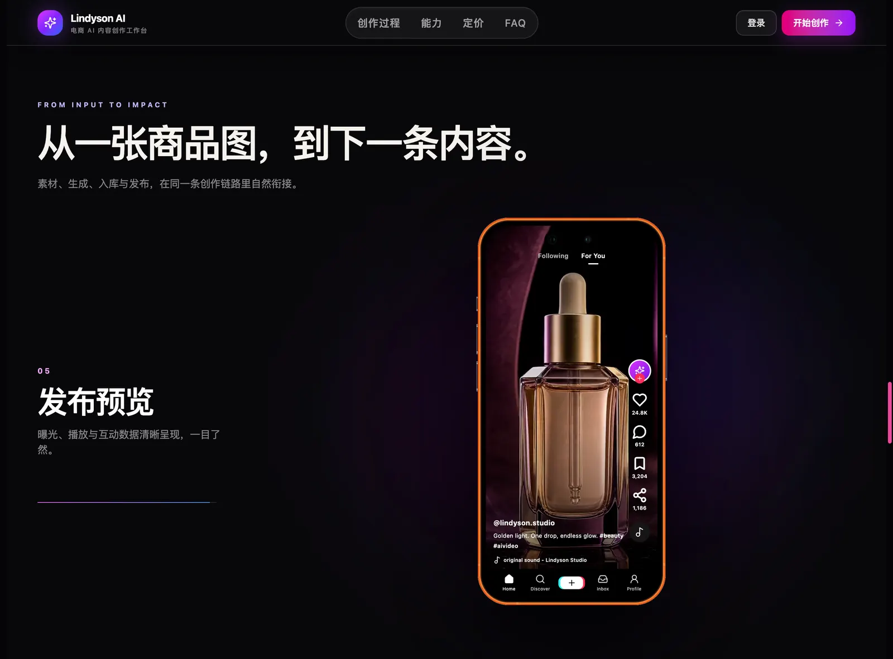 | 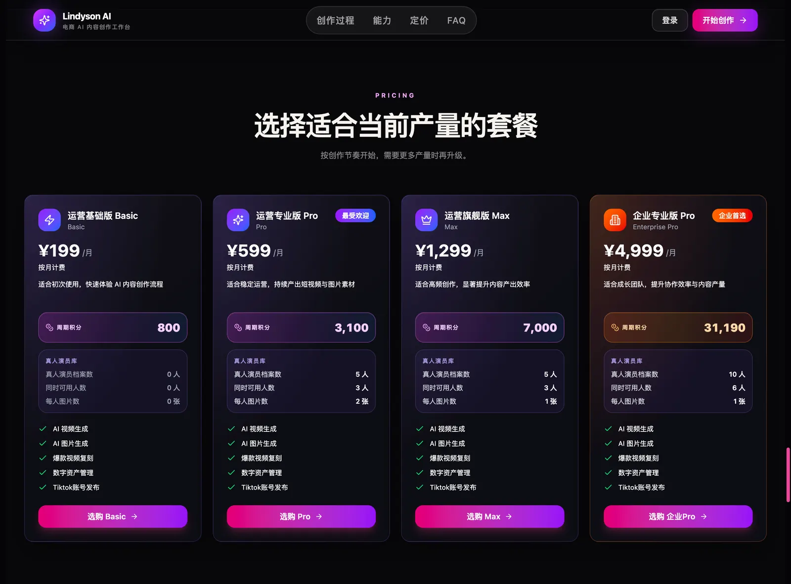 |

### 用户端

| 仪表盘 | AI Studio：视频生成 |
|---|---|
| 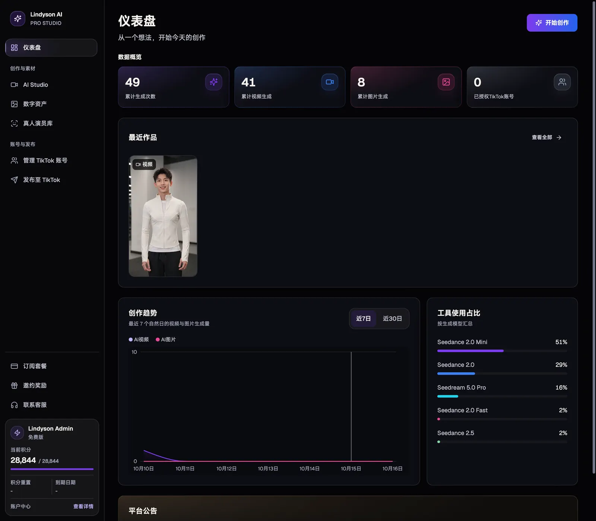 | 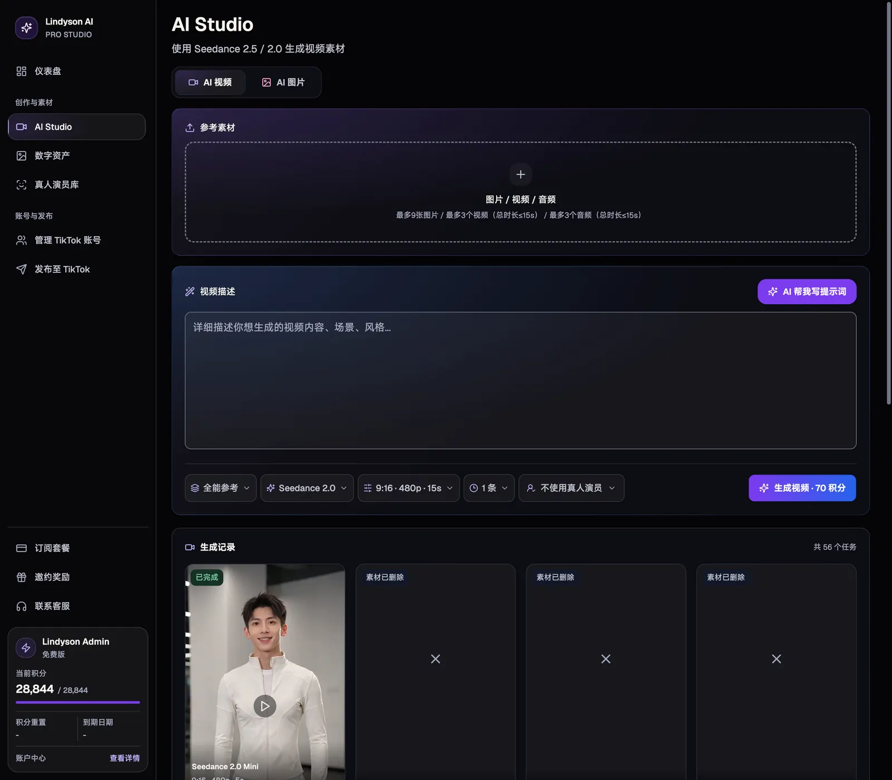 |
| **数字资产** | **TikTok 账号管理** |
| 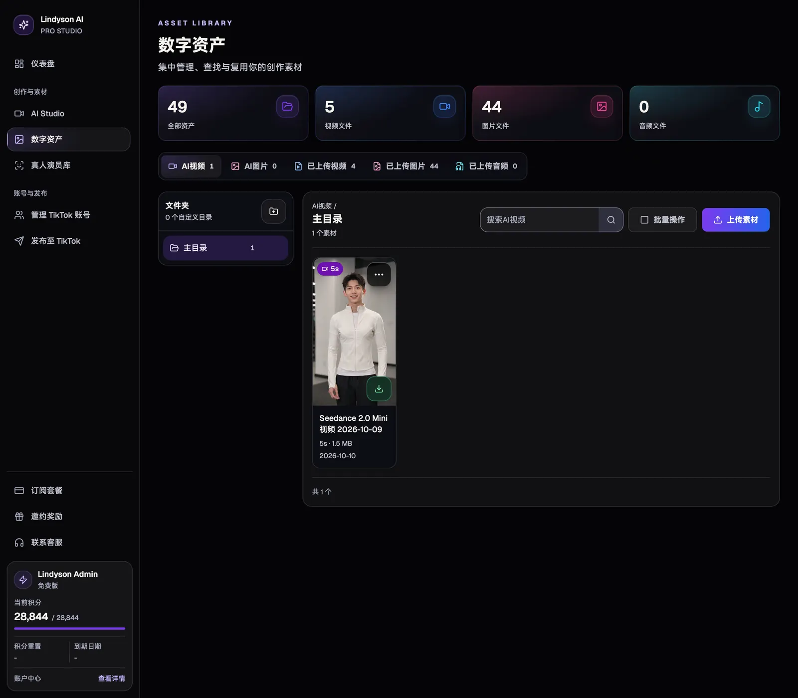 | 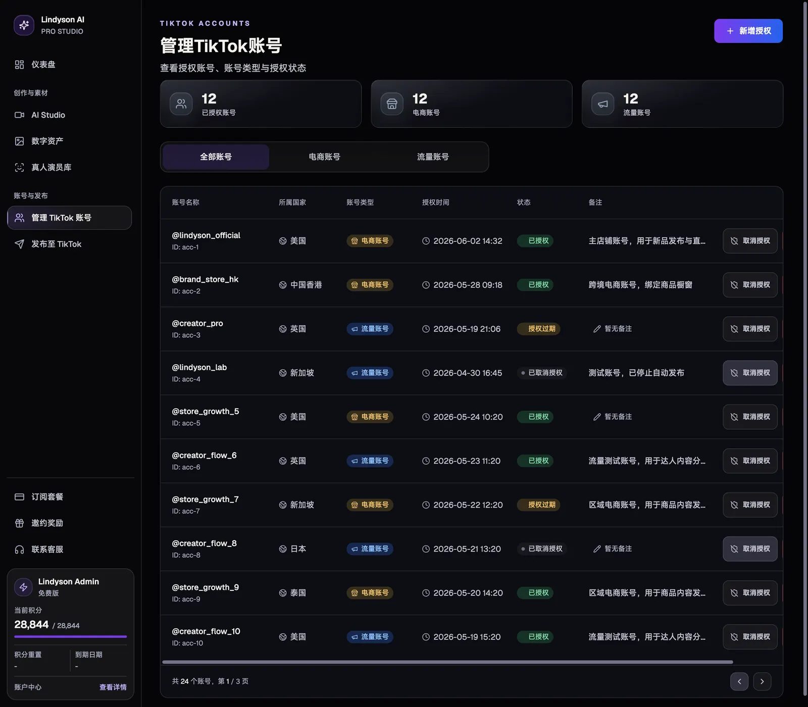 |
| **发布至 TikTok** | **账户中心：积分与 MCP 连接** |
| 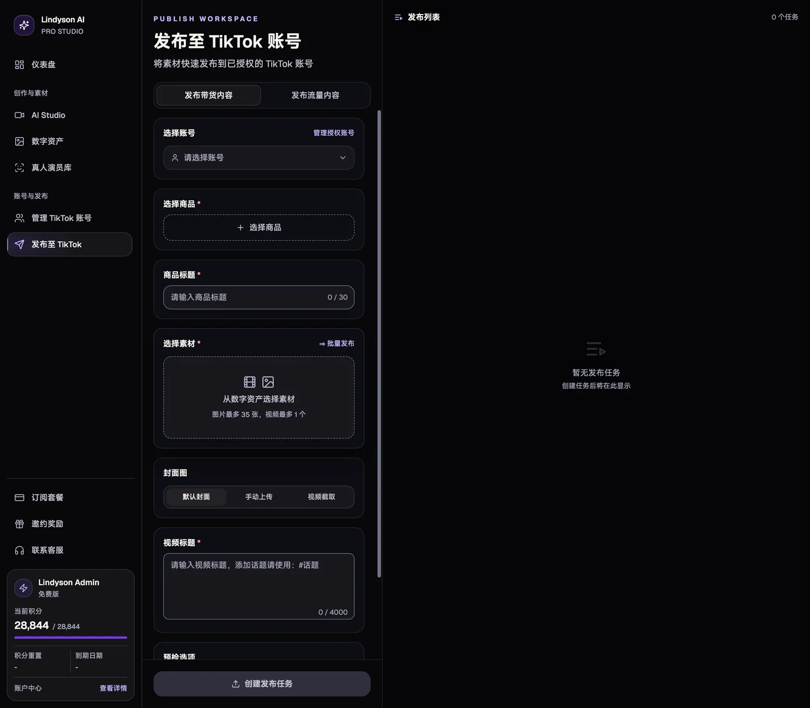 | 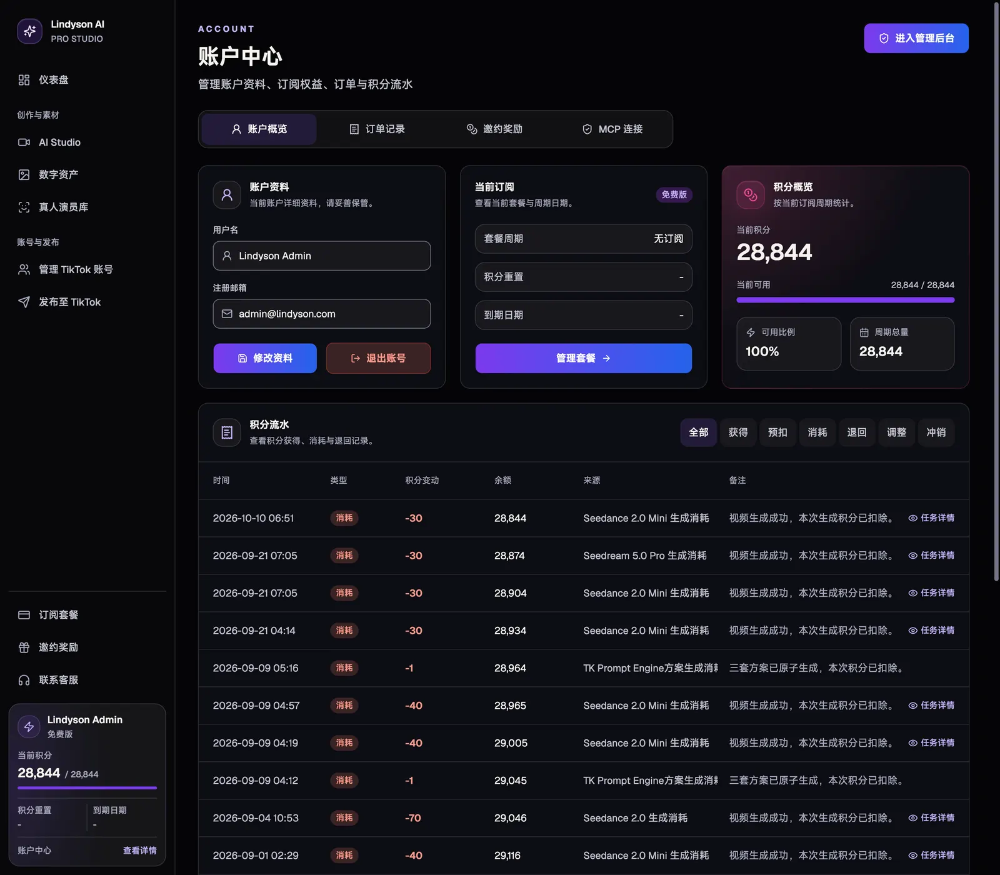 |

### 提示词引擎（核心功能）

TK Prompt Engine 从一张商品图出发：先识别并由你确认商品事实，再设定目标市场、口播语言与画面方式，最后生成"最稳、最原生、最抓眼"三套可直接执行的分镜提示词，采用后写回 AI Studio。

| 第 1 步：确认商品事实 | 第 2 步：设置市场与创作条件 | 第 3 步：三个提示词方案 |
|---|---|---|
| 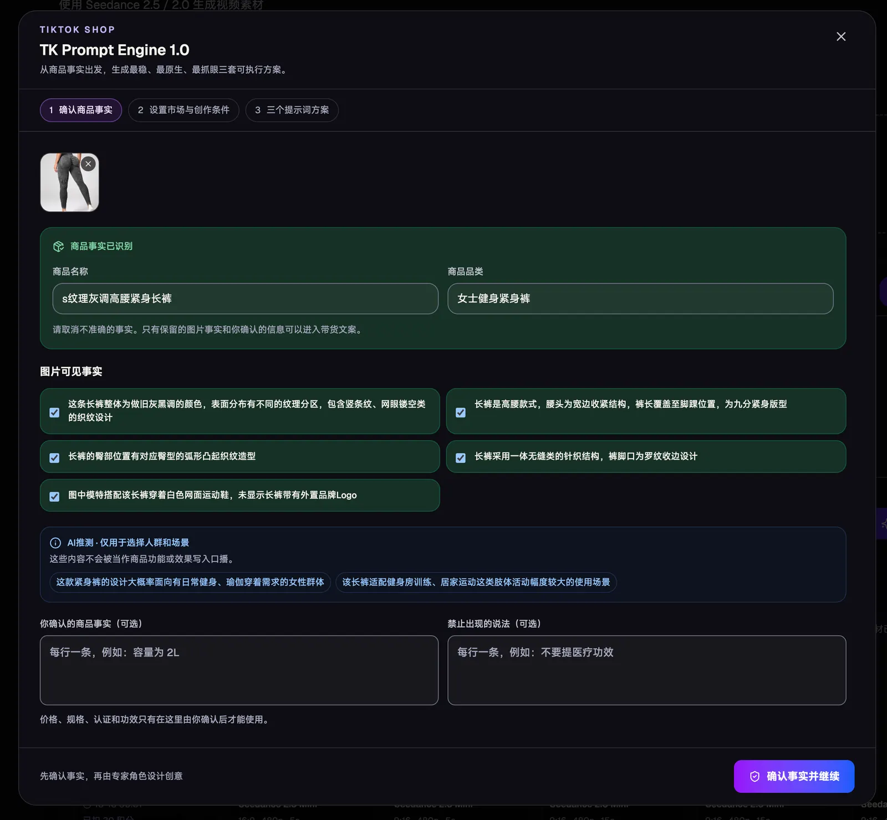 | 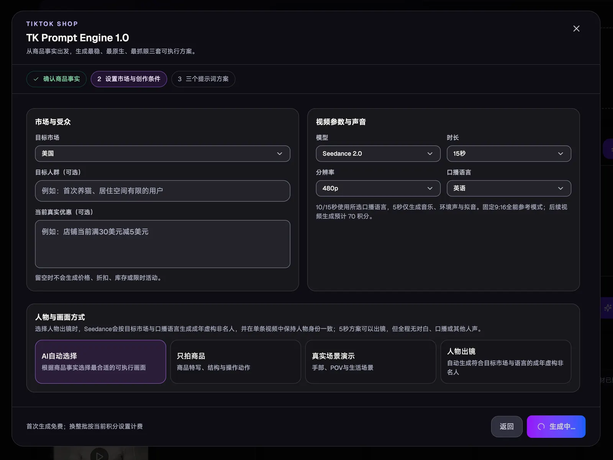 | 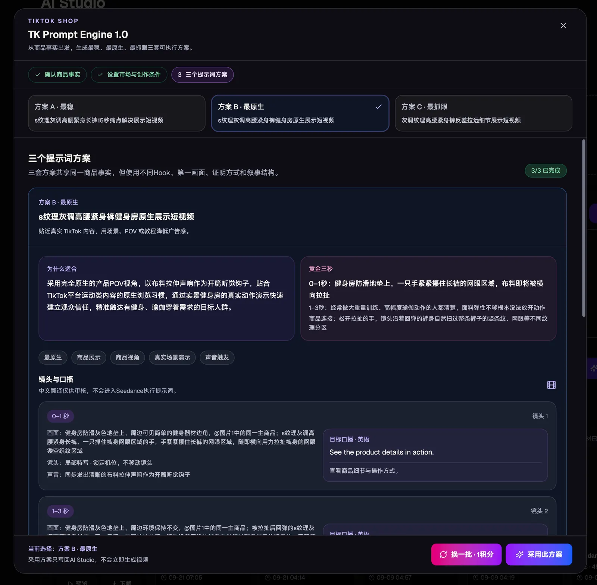 |

### 管理后台

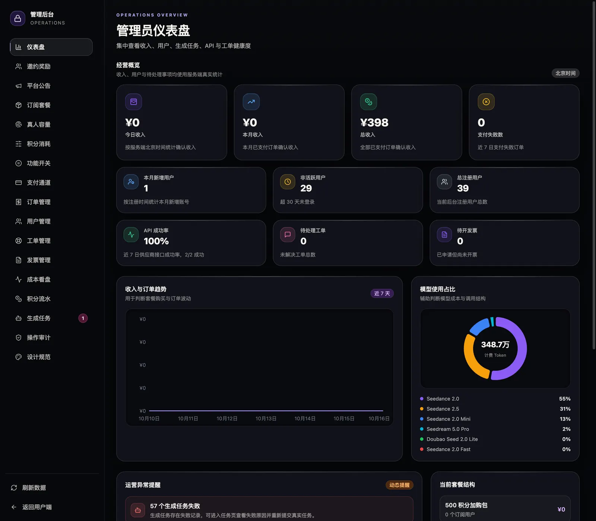

---

## 🚀 五分钟试玩

> [!TIP]
> 不需要火山引擎账号，不需要填任何密钥。演示模式用一个"假供应商"代替真实模型，生成任务约 1.5 秒后返回占位结果，整条流程（上传、生成、资产、积分、后台）都能走通。

**你需要**：一台装了 [Docker Desktop](https://www.docker.com/products/docker-desktop/)（或 Docker Engine + Compose v2.24 以上）的电脑，4 GB 以上空闲内存。

**第 1 步：拉代码**

```bash
git clone https://github.com/orylite/lindyson-ai.git && cd lindyson-ai
```

**第 2 步：一条命令启动**

```bash
docker compose --env-file .env.demo -f docker-compose.yml -f docker-compose.demo.yml up -d --build
```

第一次会构建镜像，大约 3 到 5 分钟。结束后 `docker compose ps` 里应该看到 `postgres`、`redis`、`api`、`worker`、`web` 五个容器在运行，`migrate` 显示已退出（exit 0）。

**第 3 步：打开浏览器**

访问 <http://localhost:8080>，点"登录"，用演示管理员登录：

| 账号 | 密码 |
|---|---|
| `admin@example.com` | `Demo12345` |

进入 AI Studio，随便上传一张图片，点"生成"。大约两秒后任务完成，你会在数字资产里看到一个占位结果。再去管理后台看看用户、订单、工单和供应商用量页面。

**停止与清理**

```bash
docker compose --env-file .env.demo -f docker-compose.yml -f docker-compose.demo.yml down
```

想连数据一起清掉，在末尾加 `--volumes`。

> [!NOTE]
> 演示模式的密钥和账号是公开的，并且服务端在生产模式下会拒绝这些值启动，所以它们不可能被误用于上线。想生成真实视频，请看 [部署上线](#-部署上线)。

---

## ✨ 功能一览

- 🎬 **AI Studio**：文生视频、图生视频、参考素材复用、商品图生成与交互式编辑。提示词向导把商品信息转成分镜脚本。
- 🧠 **提示词引擎**：从商品图识别事实，按目标市场和口播语言生成三套可执行的分镜提示词。
- 🗂️ **数字资产**：上传、文件夹、缩略图、批量操作，图片与视频统一管理。
- 💳 **积分与订阅**：套餐、加购包、积分流水、订单与发票。支付通道在后台配置。
- 🛠️ **管理后台**：用户、订单、工单、公告、支付通道、供应商用量与成本报表。
- 🔌 **MCP 接入**：标准 MCP 服务端加 OAuth 2.1 动态注册与 PKCE，ChatGPT 与 Codex 可直接导入素材并发起生成，见 [MCP_CHATGPT.md](MCP_CHATGPT.md)。
- 📱 **TikTok 发布**：账号管理与发布预览，成片直接推到 TikTok。
- 🧑 **真人演员库**：真人肖像授权、活体校验与撤回流程，敏感信息加密存储。

---

## 🔑 需要准备哪些账号和密钥

试玩不需要任何密钥。要生成真实视频并对外提供服务，按下面三类准备。所有变量都写在 `.env` 里，完整说明见 [.env.example](.env.example)。

> [!NOTE]
> 本项目的生成能力建立在 **火山引擎方舟** 之上。方舟是字节跳动的模型服务平台，**Seedance** 是其视频生成模型，**Seedream** 是图片生成与编辑模型，**TOS** 是火山引擎的对象存储。

### 必需：没有就生成不了真实内容

| 要什么 | 去哪拿 | 填到哪 |
|---|---|---|
| 方舟 API Key | 登录 [火山引擎控制台](https://console.volcengine.com/ark)，进入"火山方舟"，在"API Key 管理"创建一个 Key；然后在"开通管理"里开通这几个模型：Seedance 2.0（含 fast、mini）、Seedance 2.5、Seedream 5.0 Pro、Doubao Seed 2.0 lite（提示词引擎用）。按量计费，先充少量余额即可。 | `ARK_API_KEY` |
| 对象存储 | 在火山引擎 TOS 新建一个私有读写的桶，再到"访问控制 IAM"里创建一个只有该桶读写权限的子用户，拿到 Access Key。任何兼容 S3 的存储也可以用。 | `STORAGE_DRIVER=tos` 与 `TOS_*` |

### 按功能可选：不填该功能就关闭

| 功能 | 要什么 | 填到哪 |
|---|---|---|
| 提示词引擎 | 默认复用上面的方舟 Key，只要开通了 Doubao Seed 2.0 lite 模型就能用；要分开计费可以另建一个 Key | `ARK_PROMPT_WIZARD_API_KEY` |
| 真人演员库 | 火山引擎 IAM 子用户的 Access Key，调用方舟 Assets API。不能复用方舟 API Key | `REAL_PORTRAIT_PROVIDER_MODE=volcengine` 与 `VOLC_ARK_ASSET_*` |
| 成本报表 | 火山引擎费用中心的只读 Access Key，用于在后台核对账单和资源包 | `VOLC_BILLING_*` |
| 事务邮件 | [Resend](https://resend.com) 账号，并验证一个发信域名 | `RESEND_*` |
| ChatGPT / Codex 接入 | 不需要外部账号，只要你的站点有公网 HTTPS 地址 | `MCP_*`，步骤见 [MCP_CHATGPT.md](MCP_CHATGPT.md) |
| 百度收录推送 | 百度站长平台的推送 token | `BAIDU_*` |

### 自己生成：五个随机密钥

这几个值不从任何地方申请，自己生成即可，每个都不同，不要复用：

| 变量 | 用途 | 怎么生成 |
|---|---|---|
| `JWT_SECRET` | 登录会话签名 | `openssl rand -hex 32` |
| `MCP_OAUTH_SECRET` | MCP 的 OAuth 签名 | `openssl rand -hex 32` |
| `MCP_FILE_ENCRYPTION_KEY` | MCP 导入文件加密 | `openssl rand -hex 32` |
| `REAL_PORTRAIT_TOKEN_ENCRYPTION_KEY` | 真人演员库凭据加密 | `openssl rand -hex 32` |
| `PAYMENT_CONFIG_ENCRYPTION_KEY` | 支付通道密钥入库加密 | `openssl rand -base64 32`（必须是 32 字节的 Base64） |

### 支付：在后台配，自己选服务商

支付通道的密钥不写在 `.env` 里。登录管理后台，进入"支付通道"，填写服务商给你的商户号（`mchNo`）、应用 ID（`appId`）和 API 密钥（`apiKey`），保存时会用上面的 `PAYMENT_CONFIG_ENCRYPTION_KEY` 加密入库。

项目通过 [Jeepay](https://www.jeequan.com/) 这类聚合支付网关对接微信支付和支付宝。选哪家服务商、怎么申请商户号，由你根据自己的主体和地区决定；只要网关提供上述三个字段并支持异步通知，就能接上。

---

## 💻 本地开发

前置条件：Node.js 22 或更新、Docker。没有火山引擎账号也能跑通全流程，`.env.example` 默认 `ENABLE_FAKE_PROVIDER=true`，worker 会用假供应商生成占位结果。

```bash
npm i
```

```bash
cp .env.example .env
```

按 `.env.example` 的注释填写 `.env`。本地最小配置：`JWT_SECRET` 随便设一个长随机串，`STORAGE_DRIVER=local`，`ENABLE_FAKE_PROVIDER=true`，其余留空。

启动 PostgreSQL 和 Redis（也可以用自己的实例，改 `DATABASE_URL` 和 `REDIS_URL`）：

```bash
docker compose up -d postgres redis
```

初始化数据库、写入套餐种子并创建管理员（管理员邮箱和密码取自 `BOOTSTRAP_ADMIN_EMAIL`、`BOOTSTRAP_ADMIN_PASSWORD`）：

```bash
npm run db:migrate && npm run db:seed && npm run db:bootstrap-admin
```

分别在三个终端启动 API、worker 和前端：

```bash
npm run dev:api
```

```bash
npm run dev:worker
```

```bash
npm run dev
```

前端在 <http://localhost:5173>，API 在 <http://localhost:4300>，开发服务器会把 `/api/` 代理到 API。打开前端应看到落地页，登录后进入仪表盘。

---

## 🌐 部署上线

一台 2 核 4G 的机器就够跑：PostgreSQL、Redis、API、worker、前端 nginx 全在一个 `docker compose` 里。

**第 1 步：准备服务器和域名**

一台能跑 Docker 的 Linux 服务器，一个解析到它的域名（下文以 `ai.example.com` 为例）。

**第 2 步：拉代码并创建配置**

```bash
git clone https://github.com/orylite/lindyson-ai.git && cd lindyson-ai
```

```bash
cp .env.example .env
```

**第 3 步：编辑 `.env`**，至少填这些：

| 变量 | 填什么 |
|---|---|
| `NODE_ENV` | `production` |
| `JWT_SECRET`、`MCP_OAUTH_SECRET`、`MCP_FILE_ENCRYPTION_KEY`、`REAL_PORTRAIT_TOKEN_ENCRYPTION_KEY`、`PAYMENT_CONFIG_ENCRYPTION_KEY` | 按 [上一节](#自己生成五个随机密钥) 各生成一个，不要复用 |
| `POSTGRES_PASSWORD` | 数据库口令 |
| `PUBLIC_BASE_URL`、`APP_BASE_URL`、`CORS_ORIGIN` | 都填 `https://ai.example.com` |
| `VITE_PUBLIC_SITE_URL` | 同上，用于前端构建 |
| `ENABLE_FAKE_PROVIDER` | `false` |
| `ARK_API_KEY` | 方舟 API Key |
| `STORAGE_DRIVER`、`TOS_*` | `tos` 与对象存储信息 |
| `BOOTSTRAP_ADMIN_EMAIL`、`BOOTSTRAP_ADMIN_PASSWORD` | 第一个管理员账号 |

**第 4 步：填写运营主体信息**

页脚和法律文案读取 `src/app/data/publicCompliance.json`，仓库里的是占位模板。把它复制为同目录的 `publicCompliance.local.json`（已被 git 忽略）并填入真实的公司名、备案号和隐私联系方式，构建时自动替换。`npm run check:public-compliance` 可以校验是否填完整。

**第 5 步：启动**

```bash
docker compose up -d --build
```

`docker compose up` 会自动跑数据库迁移。第一次启动后再写入套餐种子并创建管理员：

```bash
docker compose run --rm --no-deps migrate npm --workspace apps/api run db:seed:prod
```

```bash
docker compose run --rm --no-deps migrate npm --workspace apps/api run db:bootstrap-admin:prod
```

此时浏览器打开 `http://你的服务器IP` 应能看到落地页。

**第 6 步：加 HTTPS**

最省事的是在前面放一个 [Caddy](https://caddyserver.com/)，它会自动申请证书。先把 `.env` 里的 `WEB_HTTP_PORT` 改成一个内网端口（例如 `8080`），`TRUST_PROXY` 改成 `2`（Caddy 和 web 两跳），然后 `docker compose up -d` 重启；再写 `Caddyfile`：

```
ai.example.com {
    reverse_proxy 127.0.0.1:8080
}
```

启动 Caddy 后访问 `https://ai.example.com`，登录管理员，到后台配置支付通道、套餐和公告，就可以开门营业了。

> [!WARNING]
> API 只应监听本机，公网流量必须经反向代理进入。`TRUST_PROXY` 填反向代理的地址、CIDR 或跳数；不要在 API 端口可直连时设为 `true`，否则客户端可伪造来源 IP 绕过限流。

<details>
<summary><strong>不用 Docker 的部署方式</strong></summary>

API 与 worker 是同一份代码，`npm run build:api` 后分别用 `node dist/server.js` 和 `node dist/worker/generationWorker.js` 启动，迁移用 `node dist/db/migrate.js`，种子与管理员用 `node dist/db/seed.js` 与 `node dist/db/bootstrapAdmin.js`。前端 `npm run build` 后把 `dist/` 交给任意静态服务器，并把 `/api/`、`/mcp`、`/oauth/`、`/.well-known/oauth-*` 反代到 API，参考 `infra/nginx/default.conf`。

</details>

<details>
<summary><strong>其他配置要点</strong></summary>

- **前端构建期变量**（`VITE_` 前缀，可写在 `.env.local`）：`VITE_PUBLIC_SITE_URL` 是正式站点地址，用于 canonical 和社交分享；`VITE_SUPPORT_QR_URL` 是客服二维码图片地址，留空则不显示。`VITE_SEEDREAM_TUTORIAL_MEDIA_BASE_URL` 指向 Seedream 教程演示媒体所在目录，这些媒体是火山引擎官方素材，不随仓库分发，留空则弹窗只显示文字与官方链接。
- `public/robots.txt` 与 `public/sitemap.xml` 里的域名需要按自己的站点修改。
- 生产环境会拒绝已知的弱密钥默认值、`http` 站点地址和公开的存储地址，启动报错时按提示修正即可。

</details>

---

## 🧯 常见问题、备份与升级

<details>
<summary><strong>启动后打开页面是 502 或空白</strong></summary>

先看 `docker compose ps`。若 `migrate` 不是 exit 0，用 `docker compose logs migrate` 看迁移报错，多数是数据库口令或 `DATABASE_URL` 不对。若 `api` 反复重启，`docker compose logs api` 会直接打印缺了哪个环境变量。

</details>

<details>
<summary><strong>创建管理员时报"必须先写入启用中的 pro 基础套餐"</strong></summary>

数据库里还没有套餐数据。先执行一次种子命令（本地 `npm run db:seed`，Docker 里 `docker compose run --rm --no-deps migrate npm --workspace apps/api run db:seed:prod`），再创建管理员。种子可以重复执行，不会覆盖已有数据。

</details>

<details>
<summary><strong>生成任务一直排队，没有结果</strong></summary>

是 worker 没跑或连不上 Redis。`docker compose logs worker` 查看；本地开发要单独开一个终端跑 `npm run dev:worker`。真实模式下还要确认 `ARK_API_KEY` 有效且对应模型已开通。

</details>

<details>
<summary><strong>假供应商生成的结果长什么样</strong></summary>

是一张占位图或一段占位视频，任务 ID 以 `fake-` 开头，不会消耗火山引擎费用。它只在 `NODE_ENV` 不是 `production` 时生效。

</details>

<details>
<summary><strong>端口 80 或 8080 被占用</strong></summary>

改 `.env`（或 `.env.demo`）里的 `WEB_HTTP_PORT`，然后重新 `up -d`。

</details>

**备份**：数据在两个 Docker 卷里，`postgres-data`（数据库）和 `local-storage`（本地存储模式下的文件）。数据库一行备份：

```bash
docker compose exec postgres pg_dump -U lindyson lindyson > lindyson-$(date +%F).sql
```

对象存储模式下文件在 TOS 桶里，按云厂商的方式备份。

**升级**：

```bash
git pull && docker compose up -d --build
```

`up` 会自动执行新的数据库迁移。升级前先做一次备份。

---

## 🧩 二次开发

### 架构

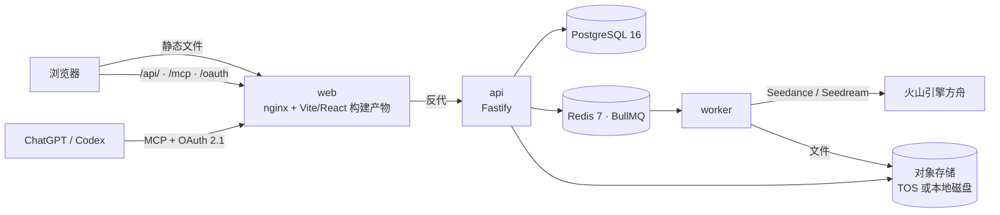

### 目录

| 目录 | 内容 |
|---|---|
| `src/` | 前端。`index.html` → `src/landing.tsx` 是落地页；`app.html` → `src/main.tsx` 是登录后的工作台与后台 |
| `apps/api/` | API、worker、数据库迁移（`migrations/`）、运维工具（`src/tools/`） |
| `apps/api/src/providers/` | 供应商层。要换模型或接别的厂商，改这里 |
| `packages/api-contracts/` | 前后端共享的 zod 契约 |
| `tests/` | Playwright 端到端测试与 Docker 全栈测试 |
| `scripts/` | 全栈测试编排、公开合规配置校验、百度收录提交 |
| `docker-compose.yml` | 单机生产栈；`docker-compose.demo.yml` + `.env.demo` 是试玩叠加；`docker-compose.fullstack.yml` 是测试叠加 |

### 开发命令

| 命令 | 作用 |
|---|---|
| `npm run typecheck` / `npm run typecheck:api` | 前端 / API 类型检查 |
| `npm run test:unit` | 前端与契约包单元测试（Vitest） |
| `npm run check:api` | API 类型检查与单元测试 |
| `npm run test:e2e` | Playwright 端到端测试（走 mock API） |
| `npm run test:fullstack` | 用 `docker-compose.yml` 加 `docker-compose.fullstack.yml` 起一套真实 PostgreSQL、Redis、API、worker 与浏览器链路 |
| `npm run build` / `npm run build:api` | 生产构建；前端构建会为文本资源额外生成 `.gz` |
| `npm run check` | 以上全部，发布前跑一遍 |

贡献流程见 [CONTRIBUTING.md](CONTRIBUTING.md)，安全问题请按 [SECURITY.md](SECURITY.md) 私下报告，版本变更见 [CHANGELOG.md](CHANGELOG.md)。

---

## 📮 联系与交流

用的时候遇到问题，开 [Issue](https://github.com/orylite/lindyson-ai/issues) 就好。想聊商业化、私有部署、接别的模型，或者只是想交流做 TK 短视频的经验，扫码加飞书：

<p align="center">
  <br>
  <sub>飞书扫一扫</sub>
</p>

---

## ⭐ Star History

觉得有用的话，点个 Star 让更多卖家和开发者看到它。

<p align="center">
  <a href="https://star-history.com/#orylite/lindyson-ai&Date">
    <picture>
      <source media="(prefers-color-scheme: dark)" srcset="https://api.star-history.com/svg?repos=orylite/lindyson-ai&type=Date&theme=dark">
      
    </picture>
  </a>
</p>

---

## 📜 第三方资源与许可

随仓库分发的第三方资源清单见 [NOTICE](NOTICE)，细节见 [ATTRIBUTIONS.md](ATTRIBUTIONS.md) 和 `public/fonts/说明.md`。首页商品图与视频均为 AI 生成，来源记录在 `src/imports/landing-masters/PROVENANCE.md`，README 顶部横幅是首页截图。母版文件不在仓库里。

本项目以 [Apache-2.0](LICENSE) 许可证开源。"Lindyson" 名称与标识不随代码授权，基于本项目发布的服务请使用自己的品牌，详见 [TRADEMARK.md](TRADEMARK.md)。
